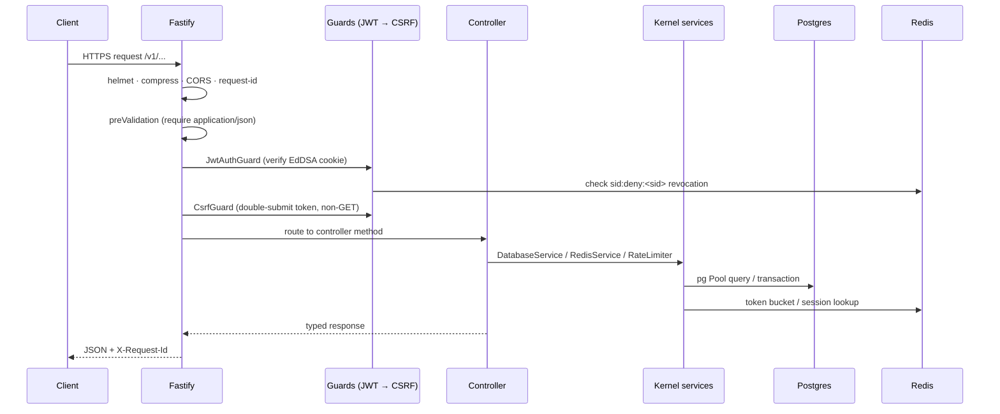
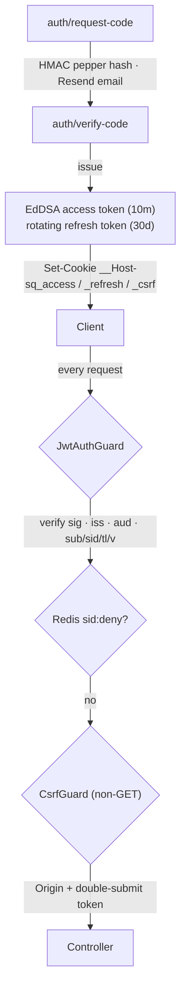
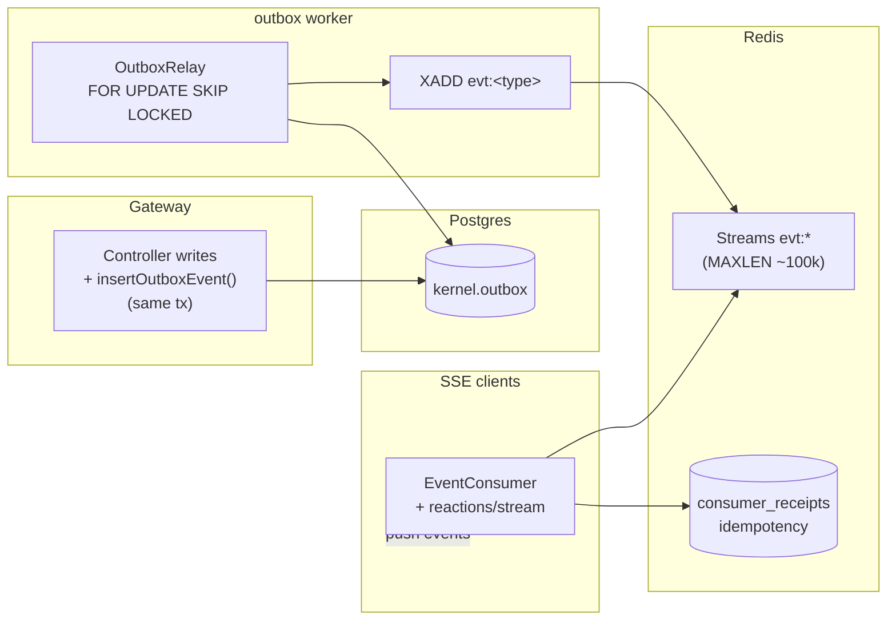
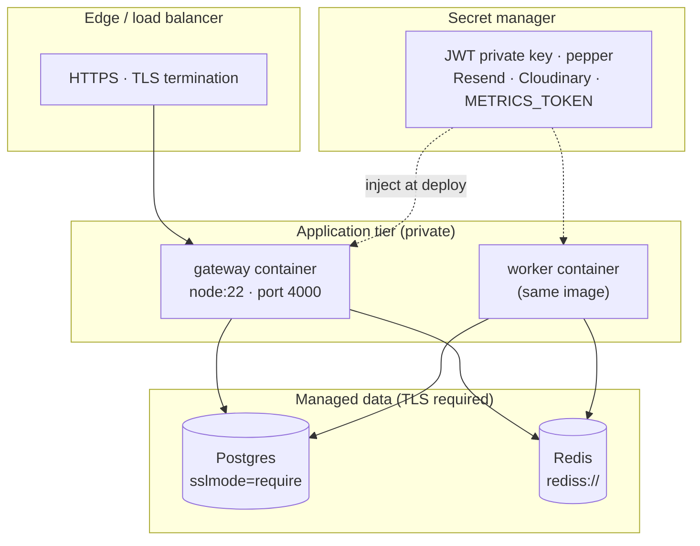
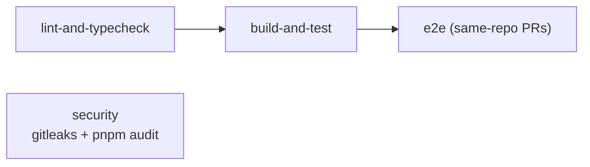

# Square Backend

The Square backend is a **NestJS + Fastify** application that serves the campus
platform API on port `4000`. Despite the directory name, `gateway` is **not a
reverse proxy** — it is the application server (a modular monolith) that mounts
every domain controller directly and talks to Postgres and Redis itself.

> **Status:** The backend is functional for local development and parity testing
> but is **not yet production-ready** (see
> [`docs/DEPLOY.md`](../docs/DEPLOY.md)). Several blueprint routes, authorization
> checks, and the full launch profile are still being implemented. The
> `backend/<domain>/` folders (auth, chat, dm, …) are currently **placeholder
> packages**; their real logic lives in `gateway/src/*.controller.ts`.

---

## Table of contents

1. [High-level architecture](#1-high-level-architecture)
2. [Repository layout](#2-repository-layout)
3. [How a request works](#3-how-a-request-works)
4. [The gateway (`backend/gateway`)](#4-the-gateway-backendgateway)
5. [The kernel (`backend/kernel`)](#5-the-kernel-backendkernel)
6. [Domain service folders (stubs)](#6-domain-service-folders-stubs)
7. [Database & migrations (`backend/db`)](#7-database--migrations-backenddb)
8. [Shared package (`shared/`)](#8-shared-package-shared)
9. [Authentication & security](#9-authentication--security)
10. [Events, outbox & realtime](#10-events-outbox--realtime)
11. [Local development](#11-local-development)
12. [Production deployment](#12-production-deployment)
13. [CI/CD](#13-cicd)
14. [Environment variables](#14-environment-variables)
15. [Scripts reference](#15-scripts-reference)
16. [File & folder responsibility map](#16-file--folder-responsibility-map)

---

## 1. High-level architecture

```mermaid
flowchart LR
    subgraph Client["Client"]
        FE["Next.js frontend<br/>(port 3000)")
    end

    subgraph Backend["Backend (port 4000)"]
        GW["gateway<br/>NestJS + Fastify<br/>REST + SSE"]
        WK["outbox worker<br/>(same image)"]
    end

    subgraph Data["Managed data"]
        PG[("PostgreSQL<br/>Supabase / self-host")]
        RD[("Redis<br/>sessions · rate limit · streams")]
    end

    subgraph External["External services"]
        RESEND["Resend<br/>(email codes)"]
        CLOUD["Cloudinary<br/>(media)"]
    end

    FE -->|"HTTPS · /v1/*"| GW
    GW --> PG
    GW --> RD
    WK --> PG
    WK --> RD
    GW -.->|"prod: send login code"| RESEND
    GW -.->|"uploads (planned)"| CLOUD
```

**Key idea:** one codebase, one image, two runtimes — an **HTTP server**
(`main.ts`) and a **background worker** (`worker.main.ts`) — plus two CLIs
(`migrate.ts`, `status.ts`). All domain logic is consolidated in the gateway;
`kernel` is the shared library; `db/migrations` is the canonical schema.

---

## 2. Repository layout

```
square/
├── backend/
│   ├── gateway/              # @square/gateway — the running API + worker (port 4000)
│   │   ├── Dockerfile        # production image (migrate + start)
│   │   └── src/
│   │       ├── main.ts            # HTTP bootstrap (Fastify, CORS, metrics, Swagger)
│   │       ├── app.module.ts      # root Nest module — wires controllers + providers
│   │       ├── worker.main.ts     # outbox worker bootstrap (no HTTP)
│   │       ├── worker.module.ts   # worker Nest module
│   │       ├── outbox.worker.ts   # polls OutboxRelay → Redis streams
│   │       ├── migrate.ts         # SQL migration runner (tsx)
│   │       ├── status.ts          # DB inspection CLI (tsx)
│   │       ├── dummy.ts           # dev-only dummy service (port 4010)
│   │       ├── tokens.ts          # BACKEND_CONFIG injection token
│   │       ├── health.controller.ts        # /healthz /readyz /metrics
│   │       ├── gateway.controller.ts       # /config, dev dummy probe
│   │       ├── identity.controller.ts      # auth, sessions, profile, blocks
│   │       ├── platform.controller.ts      # communities, members, invites, assets
│   │       ├── conversation.controller.ts  # chat + DM messaging
│   │       ├── content.controller.ts       # posts, events, lists, boards, campaigns
│   │       ├── moderation.controller.ts    # reports, timeouts, bans, audit log
│   │       ├── reactions.controller.ts     # reaction REST + SSE stream
│   │       ├── reactions.service.ts        # reaction business logic
│   │       └── reactions.scheduler.ts      # daily count reconciliation
│   ├── kernel/                # @square/kernel — shared core library
│   │   └── src/
│   │       ├── config.ts        # Zod env schema + parseBackendConfig
│   │       ├── auth.ts          # JWT guard, CSRF guard, cookie helpers
│   │       ├── database.ts      # pg Pool + Kysely DatabaseService
│   │       ├── redis.ts         # ioredis RedisService
│   │       ├── rate-limiter.ts  # Redis Lua token-bucket limiter
│   │       ├── outbox.ts        # OutboxRelay, EventConsumer, insertOutboxEvent
│   │       ├── errors.ts        # ApiException + global ApiExceptionFilter
│   │       └── cursor.ts        # base64url cursor encode/decode
│   ├── db/                    # canonical schema (no package.json)
│   │   ├── migrations/          # 0001…0011 raw .sql files
│   │   └── seeds/               # (empty — seed data is inline in migrations)
│   ├── auth/ badges/ boards/ campaigns/ chat/ communities/ discover/ dm/
│   ├── events/ feeds/ lists/ media/ moderation/ notifications/ realtime/
│   └── search/ users/ assets/  # @square/<name> placeholder packages (stubs)
├── shared/                    # @square/shared — zod schemas, types, constants
├── frontend/                  # Next.js app (port 3000)
├── infra/docker/              # local-dev docker-compose + frontend Dockerfile
├── scripts/parity-backend.mjs # isolated parity test stack
├── docs/                      # blueprint, deploy guide, parity matrix
├── .github/workflows/ci.yml   # lint · typecheck · security · build · e2e
├── turbo.json                 # turbo build orchestration
├── pnpm-workspace.yaml        # workspaces: frontend, shared, backend/*
└── package.json               # root scripts (pnpm@11.5.0, node >=22)
```

---

## 3. How a request works



**Boot sequence** (`gateway/src/main.ts`):

1. Load `.env` from repo root (`../../../.env`).
2. `parseBackendConfig(process.env)` — Zod-validates every variable; **fails fast**
   with a precise message if invalid.
3. `validateJwtKeyPair(config)` — imports the Ed25519 keys and does a sign/verify
   probe.
4. Create `NestFastifyApplication` with a redacting logger, 64 KB body limit,
   UUID request ids.
5. Register `helmet` + `compress`, configure CORS from `CORS_ORIGINS`.
6. Add hooks: `onRequest` (timing + `X-Request-Id`), `preValidation` (JSON
   enforcement → 415), `onResponse` (Prometheus counter + histogram).
7. Global prefix `v1` (health/metrics excluded), global `ApiExceptionFilter`,
   shutdown hooks, default metrics.
8. Swagger UI at `/docs` (non-production only).
9. `listen(PORT, "0.0.0.0")`.

---

## 4. The gateway (`backend/gateway`)

Package `@square/gateway`. The single `AppModule` registers **8 controllers**
and wires kernel services via `useFactory`:

| Controller | Responsibility | Example routes (under `/v1`) |
|---|---|---|
| `HealthController` | liveness / readiness / metrics | `GET /healthz`, `GET /readyz`, `GET /metrics` |
| `GatewayController` | public config + dev probe | `GET /config`, `GET /_dev/dummy/health` |
| `IdentityController` | auth, sessions, profile, blocks | `auth/request-code`, `auth/verify-code`, `auth/refresh`, `me`, `me/blocks` |
| `PlatformController` | communities, members, invites, assets | `communities`, `communities/:id/join`, `invites/:id/accept`, `assets` |
| `ConversationController` | chat + DM messaging | `assets/:id/messages`, `dm/conversations/:id/messages`, `me/unread` |
| `ContentController` | posts, events, lists, boards, campaigns | `assets/:id/posts`, `events/:id/rsvp`, `assets/:id/items` |
| `ModerationController` | reports, timeouts, bans, audit | `reports`, `moderation/timeouts`, `moderation/bans` |
| `ReactionsController` | reactions REST + SSE | `reactions`, `reactions/stream` (SSE) |

**Providers** (`app.module.ts`): `BACKEND_CONFIG`, `DatabaseService`,
`RedisService`, `RedisRateLimiter`, `ReactionsService`, `ReactionsScheduler`,
`OutboxRelay`, two `APP_GUARD`s (`JwtAuthGuard`, `CsrfGuard`), and
`ApiExceptionFilter`.

> The `SERVICES` env var is parsed and logged but **not used for dispatch** —
> there is no service registry or proxy. The gateway *is* the backend.

---

## 5. The kernel (`backend/kernel`)

Package `@square/kernel`. A framework-light shared library consumed by the
gateway. Every file:

| File | Role |
|---|---|
| `config.ts` | Zod schema for all env vars + `parseBackendConfig`; enforces production hardening (HTTPS CORS, required secrets, SSL modes). |
| `auth.ts` | `JwtAuthGuard` (EdDSA verify, Redis deny-list), `CsrfGuard` (double-submit, `timingSafeEqual`), cookie name helpers (`__Host-sq`/`__Secure-sq`), key-pair validation. |
| `database.ts` | `DatabaseService` — `pg.Pool` (3s connect, 5s statement timeout) + Kysely; `transaction()` helper; `probe()` readiness check; graceful shutdown. |
| `redis.ts` | `RedisService` — `ioredis` with `lazyConnect`, offline queue disabled, retry strategy; `probe()` ping. |
| `rate-limiter.ts` | `RedisRateLimiter` — Lua token-bucket via `redis.eval`; returns `{allowed, limit, remaining, retryAfterMs}`. |
| `outbox.ts` | `insertOutboxEvent`, `OutboxRelay` (`FOR UPDATE SKIP LOCKED` → Redis stream `evt:<type>`), `EventConsumer` (idempotent via `consumer_receipts`). |
| `errors.ts` | `ApiException` + global `ApiExceptionFilter` → uniform `{error:{code,message,field,requestId}}`. |
| `cursor.ts` | base64url cursor codec (`{id, score?}`) for pagination. |

---

## 6. Domain service folders (stubs)

The folders `auth/`, `badges/`, `boards/`, `campaigns/`, `chat/`,
`communities/`, `discover/`, `dm/`, `events/`, `feeds/`, `lists/`, `media/`,
`moderation/`, `notifications/`, `realtime/`, `search/`, `users/`, `assets/`
are **placeholder packages** (`@square/<name>`, v0.0.0, zero dependencies, a
one-line `src/index.ts`). They mark **logical domain boundaries**; the real
implementation is consolidated in `gateway/src/*.controller.ts` and the schema
in `db/migrations/`. They exist so the monorepo can grow into per-service
packages later without re-structuring.

| Folder | Domain (implemented in gateway) |
|---|---|
| `auth` / `users` | identity, sessions, profiles, blocks → `identity.controller.ts` |
| `communities` / `assets` / `media` | communities, memberships, assets → `platform.controller.ts` |
| `chat` / `dm` | chat + direct messages → `conversation.controller.ts` |
| `feeds` / `events` / `lists` / `boards` / `campaigns` | content → `content.controller.ts` |
| `moderation` | reports, timeouts, bans → `moderation.controller.ts` |
| `discover` / `search` | school search via `pg_trgm` indexes |
| `notifications` / `realtime` | unread counts, SSE/outbox (kernel) |
| `badges` | achievements (future) |

---

## 7. Database & migrations (`backend/db`)

- **No ORM migration framework.** Schema is managed by **hand-written `.sql`
  files** applied by a custom runner (`gateway/src/migrate.ts`).
- Migrations live in `backend/db/migrations/` and run in lexicographic order:

| # | File | Adds |
|---|---|---|
| 0001 | `kernel.sql` | `kernel.outbox`, `kernel.consumer_receipts` |
| 0002 | `message_reactions.sql` | `users`, `communities`, `assets`, `chat`, `dm`, `moderation` schemas + reactions |
| 0003 | `identity_and_platform.sql` | `identity.accounts/sessions`, `users.schools` seed |
| 0004 | `platform_content.sql` | expanded communities, assets, chat, dm (read cursors, mentions) |
| 0005 | `content_assets.sql` | `feeds`, `events`, `lists`, `boards`, `campaigns`, `badges` |
| 0006 | `auth_sessions.sql` | session columns, `refresh_token_history`, `login_events` |
| 0007 | `dm_message_compatibility.sql` | rename `dm.messages` columns |
| 0008 | `moderation_workflows.sql` | `moderation.reports`, `community_audit_log` |
| 0009 | `community_invites.sql` | `communities.invites` |
| 0010 | `student_verification.sql` | `email_domains`, `verified_at` |
| 0011 | `institution_directory.sql` | `pg_trgm`, `school_aliases`, trigram indexes |

- The runner uses `DIRECT_URL ?? DATABASE_URL`, ensures `kernel.schema_migrations`
  exists, applies each unapplied file in a transaction, and records it.
- `DatabaseService.probe()` refuses to start if `kernel.schema_migrations` is
  missing — i.e. **migrations must run before the gateway starts**.

```bash
pnpm db:migrate   # apply pending migrations
pnpm db:status    # inspect schemas/tables/migration count
```

---

## 8. Shared package (`shared/`)

`@square/shared` — framework-agnostic TypeScript reused by frontend **and**
backend:

- `schemas.ts` — Zod schemas (auth, reactions, mentions, unread, schools).
- `types.ts` — domain types (Community, Asset, User, Post, DM, …).
- `username.ts` — Unicode-aware username rules (min 4 / max 24, `#` prefix).
- `reactions.ts` — 8 quick reactions, limits, RGI emoji allowlist.
- `assetCatalog.ts` — default + optional asset catalog with role permissions.
- `config.ts` — feature toggles. `plural.ts` — `Intl.PluralRules` helper.

---

## 9. Authentication & security



- **Tokens:** Ed25519/EdDSA via `jose`; access 10 min, refresh 30 d with
  rotation + reuse detection (`identity.refresh_token_history`).
- **Cookies:** `__Host-sq` prefix (or `__Secure-sq` when `COOKIE_DOMAIN` set);
  `HttpOnly`, `Secure`, `SameSite`.
- **CSRF:** double-submit token compared with `timingSafeEqual`; Origin checked
  against `CORS_ORIGINS`.
- **Hardening:** helmet (HSTS in prod), request-id redaction of auth/cookie/url
  headers, 64 KB body limit, JSON-only enforcement, Redis token-bucket rate
  limiting, production Zod checks (HTTPS CORS, `METRICS_TOKEN`, JWT keys,
  `AUTH_CODE_PEPPER` ≥32, Resend, DB `sslmode`, Redis `rediss://`).

---

## 10. Events, outbox & realtime

The **transactional outbox** pattern decouples writes from async consumers:



- `insertOutboxEvent()` writes to `kernel.outbox` and `pg_notify` in the same
  transaction as the domain change.
- `OutboxRelay` (worker) reads unpublished rows `FOR UPDATE SKIP LOCKED`, pushes
  to Redis stream `evt:<type>`, marks `published_at`.
- `EventConsumer` + `GET /v1/reactions/stream` (SSE) deliver realtime reaction
  updates; idempotency via `kernel.consumer_receipts`.
- `ReactionsScheduler` reconciles reaction counts daily at 00:00 UTC.

---

## 11. Local development

```bash
pnpm install
cp .env.example .env            # fill DATABASE_URL, REDIS_URL, JWT keys
pnpm db:migrate                 # apply SQL migrations
pnpm dev:backend                # gateway on :4000 (tsc watch + node --watch)
pnpm start:worker               # outbox worker (separate terminal)
```

- Swagger UI: <http://localhost:4000/docs> · OpenAPI: `/docs/openapi.json`
- Health: `GET /healthz` (liveness) · `GET /readyz` (DB+Redis) · `GET /metrics`
- Parity stack (isolated Docker Compose on ports 4400/55432/56379):
  `pnpm backend:up` · `pnpm backend:reset` · `pnpm backend:down`
- Full parity suite: `pnpm parity` (mock + real)

---

## 12. Production deployment

> The repo **does not yet ship a production CD pipeline** — no deploy workflow,
> no Terraform/K8s, no managed secrets integration. What follows is the intended
> topology and the building blocks that already exist.



**Building blocks that exist today:**

| Concern | Where | Notes |
|---|---|---|
| Production image | `backend/gateway/Dockerfile` | `node:22-bookworm-slim`; `pnpm install --frozen-lockfile && pnpm build:backend`; `NODE_ENV=production`; runs as `node`; `CMD` = **migrate then start**. |
| Local/dev orchestration | `infra/docker/docker-compose.yml` | `gateway` + `postgres` + `redis`; `worker` under `launch` profile; health-gated startup. |
| Frontend image | `infra/docker/frontend.Dockerfile` | multi-stage, non-root, port 3000 (optional). |
| Config contract | `backend/kernel/src/config.ts` | Zod schema; **fails fast** on missing/invalid prod vars. |
| Migrations at boot | `gateway/Dockerfile` `CMD` | `migrate` runs before `start`, so schema is always current. |
| Health gates | `/healthz`, `/readyz` | LB/orchestrator readiness = Postgres + Redis reachable. |
| Metrics | `GET /metrics` | Prometheus; protected by `METRICS_TOKEN` in prod. |

**Intended production flow:**

1. Build the image from repo root: `docker build -f backend/gateway/Dockerfile -t square-gateway .`
2. Inject secrets from your secret manager as env vars (never bake `.env` into
   the image — `.dockerignore` excludes it).
3. Run **gateway** and **worker** containers from the same image (worker command
   `pnpm start:worker`), both pointing at the managed Postgres (`sslmode=require`)
   and Redis (`rediss://`).
4. The gateway container's `CMD` applies pending migrations before listening, so
   schema is always current on rollout.
5. Terminate TLS at the edge/LB and forward to the gateway's port 4000; set
   `CORS_ORIGINS` to the exact public HTTPS origins.

**Required production env** (enforced by `config.ts`): `NODE_ENV=production`,
`METRICS_TOKEN` (≥32 chars), `JWT_PUBLIC_KEY` + `JWT_PRIVATE_KEY`,
`AUTH_CODE_PEPPER` (≥32), `RESEND_API_KEY` + `RESEND_SENDER_EMAIL`,
`DATABASE_URL` with `sslmode=require`, `REDIS_URL` with `rediss://`, HTTPS-only
`CORS_ORIGINS`.

---

## 13. CI/CD

`.github/workflows/ci.yml` runs on push to `main` and every PR:



| Job | What it does |
|---|---|
| `lint-and-typecheck` | `pnpm install --frozen-lockfile` → `pnpm lint` → `pnpm typecheck` (turbo). |
| `security` | `gitleaks` secret scan + `pnpm audit --prod`. |
| `build-and-test` | `pnpm build:frontend` + shared tests against `origin/main`. |
| `e2e` | Playwright against frontend (same-repo PRs only). |

Pre-commit hooks (`.husky/`): `gitleaks protect --staged` + `lint-staged`;
commit-msg: `commitlint` (conventional commits). **No deploy job exists yet.**

---

## 14. Environment variables

Copy `.env.example` (repo root) to `.env`. Backend-parsed variables (see
`kernel/src/config.ts`):

| Variable | Default | Purpose |
|---|---|---|
| `NODE_ENV` | `development` | `development` / `test` / `production` |
| `PORT` | `4000` | HTTP listen port |
| `SERVICES` | `all` | informational (logged, not used for dispatch) |
| `DATABASE_URL` | local pg | Postgres (pgbouncer) connection string |
| `DIRECT_URL` | — | session-mode pooler for migrations |
| `REDIS_URL` | `redis://127.0.0.1:6379` | Redis connection |
| `DB_POOL_MAX` | `6` | pg pool size (1–20) |
| `CORS_ORIGINS` | `http://localhost:3000` | comma-separated exact origins |
| `JWT_ISSUER` / `JWT_AUDIENCE` | `square` / `square-api` | token iss/aud |
| `JWT_PUBLIC_KEY` / `JWT_PRIVATE_KEY` | — | Ed25519 PEM (required in prod) |
| `JWT_KEY_ID` | `v1` | key id |
| `AUTH_CODE_PEPPER` | — | HMAC pepper for login codes (≥32 in prod) |
| `COOKIE_DOMAIN` | — | parent domain (e.g. `.example.com`) |
| `METRICS_TOKEN` | — | protects `/metrics` (required in prod) |
| `RESEND_API_KEY` / `RESEND_SENDER_EMAIL` / `RESEND_SENDER_NAME` | — / — / `Square` | email delivery (required in prod) |
| `CLOUDINARY_*` | — | media (cloud name, key, secret, folder) |
| `SIGNUP_ENABLED` `DM_ENABLED` `UPLOADS_ENABLED` | `true` | feature switches |
| `ENABLE_TYPING` `ENABLE_PUSH` | `false` | feature switches |
| `AUTH_TEST_MODE` | `false` | **test only** — code `123456` |
| `DUMMY_SERVICE_URL` | `http://127.0.0.1:4010` | dev dummy health probe |

`.env` / `.env.*` are gitignored (only `.env.example` is committed).

---

## 15. Scripts reference

Root `package.json` (run from repo root):

| Script | Command |
|---|---|
| `dev:backend` | gateway watch mode |
| `start:backend` / `start:worker` | run built gateway / worker |
| `build:backend` / `test:backend` | turbo build/test for `@square/gateway...` |
| `db:migrate` / `db:status` | apply / inspect migrations |
| `backend:up` / `backend:down` / `backend:reset` | parity Docker stack |
| `parity` / `parity:mock` / `parity:real` | parity suites |
| `lint` / `typecheck` / `test` | turbo across monorepo |

Gateway package (`backend/gateway`): `dev`, `start`, `start:worker`,
`start:dummy`, `migrate`, `status`, `build`, `lint`/`typecheck`, `test`.

---

## 16. File & folder responsibility map

| Path | Responsible for |
|---|---|
| `backend/gateway/src/main.ts` | HTTP bootstrap, Fastify plugins, CORS, hooks, metrics, Swagger |
| `backend/gateway/src/app.module.ts` | DI wiring: controllers + kernel providers + guards |
| `backend/gateway/src/*.controller.ts` | HTTP routes + domain logic per area |
| `backend/gateway/src/worker.main.ts` / `worker.module.ts` / `outbox.worker.ts` | background outbox relay |
| `backend/gateway/src/migrate.ts` | apply SQL migrations |
| `backend/gateway/src/status.ts` | DB inspection CLI |
| `backend/gateway/Dockerfile` | production image (migrate + start) |
| `backend/kernel/src/config.ts` | env schema + validation + prod hardening |
| `backend/kernel/src/auth.ts` | JWT/CSRF guards, cookies, key validation |
| `backend/kernel/src/database.ts` / `redis.ts` | Postgres / Redis services |
| `backend/kernel/src/rate-limiter.ts` | distributed token-bucket limiting |
| `backend/kernel/src/outbox.ts` | transactional outbox + Redis streams |
| `backend/kernel/src/errors.ts` | uniform error envelope |
| `backend/kernel/src/cursor.ts` | pagination cursors |
| `backend/db/migrations/*.sql` | canonical schema (11 migrations) |
| `backend/<domain>/` | placeholder domain packages (future split) |
| `shared/src/*` | zod schemas, types, username/reaction rules |
| `infra/docker/docker-compose.yml` | local/dev orchestration |
| `infra/docker/frontend.Dockerfile` | frontend image |
| `scripts/parity-backend.mjs` | isolated parity test stack |
| `.github/workflows/ci.yml` | CI: lint, typecheck, security, build, e2e |
| `turbo.json` / `pnpm-workspace.yaml` | monorepo build orchestration |
| `docs/backend-blueprint.md` | authoritative backend spec |
| `docs/DEPLOY.md` | deployment + parity guide |